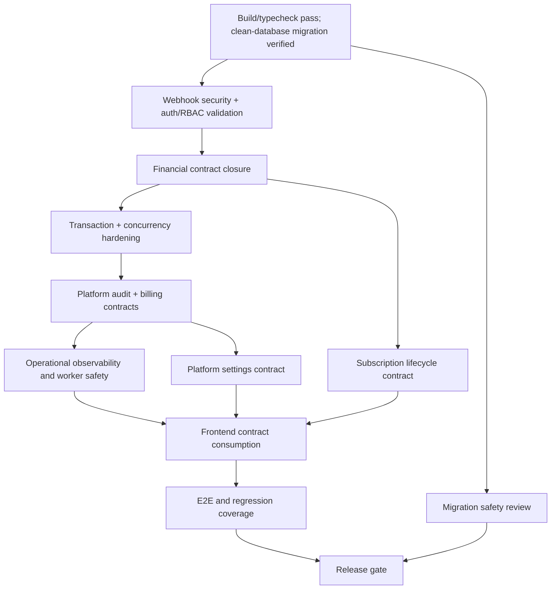

# Gap Closure Dependency Map

## Dependency flow

## Blocking dependencies

### Payment security dependency chain

- SEC-001 resolved using the documented Xendit `x-callback-token` contract; provision the secret in production
- SEC-003 is resolved: ownership checks, atomic assignment replacement, notification owner scoping, explicit order/tenant/audit permissions, exhaustive fail-closed permission classification, and tenant-isolation regressions pass
- SEC-004's isolated OIDC/MFA implementation is complete; Keycloak is the approved production IdP, while exact realm/`acr`, provisioned operators, and real sign-in remain a release blocker
- Financial mutation hardening required
- DATA-001 invoice numbering is resolved
- Audit verification required
- E2E flow validation required

### Platform admin dependency chain

- API-001 platform billing aggregate contract is resolved
- Frontend dashboard consumes the authorized platform billing aggregate; unsupported refund/reconciliation actions remain unavailable
- ARCH-001 platform audit/outbox/mutation transaction boundary is resolved for reviewed operations
- API-002 remains scope-limited with unsupported financial operations unavailable
- UI surfaces must remain explicit about unsupported functions until contract is added

### Worker / observability dependency chain

- Worker registry, heartbeat, durable job projection, and authorized worker read endpoints exist (OPS-001 RESOLVED WITH GAP)
- Job-history query, scheduler execution-history, and DLQ contracts remain absent
- Retry-series PostgreSQL/Redis integration evidence passes for the covered worker retry flow
- Monitoring and alert policy remain external to the application

### Deployment dependency chain

- Root build, lint, and typecheck pass for the current implementation; DEP-001 is RESOLVED WITH GAP because production artifacts and release evidence remain unverified
- The repository and dedicated test database contain all 62 migrations; migration status and schema-drift checks pass. A full test-database backup was restored to an isolated PostgreSQL 18 clone, which passed migration-status and schema-drift checks. The current migration/schema status of production `cafe_os` is unknown and it was not accessed; production approval and post-deployment checks remain separate release evidence (OPS-002, Resolved with Gap)
- API E2E and audit-integration cases cover tenant isolation, invalid webhook rejection, platform reads, telemetry authorization, and audit immutability. Latest full API validation passed 102 unit suites / 452 tests, 24 integration suites / 130 tests, and 7 E2E suites / 23 tests (133 suites / 605 tests total). Broader lifecycle/browser flows remain (TEST-001, Resolved with Gap)
- Inventory now exposes tenant-scoped available, reserved, and on-hand quantity snapshots. Reorder policy is a separate business decision and no automatic PO creation is permitted until approved (INV-002, Resolved with Gap)
- Release safety still requires an environment-specific deployment and recovery procedure
- OBS-001 now exposes bounded, protected historical request metrics and redacted operational events; raw logs, system metrics, and alerting remain external

## Important execution rule

The backlog must not be implemented in severity order alone. Contract work precedes frontend work; concurrency hardening precedes UI expansion; security verification precedes financial workflow expansion.
